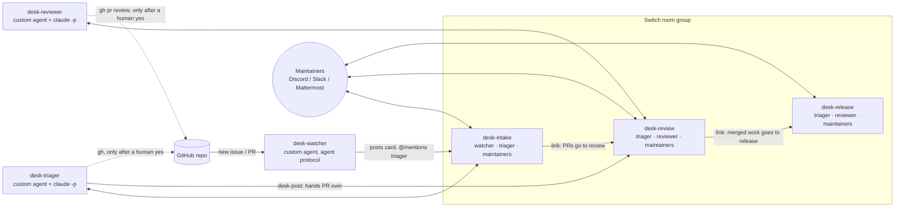

# Maintainer Desk

[](https://github.com/YashThokal777/maintainer-desk/actions/workflows/tests.yml)

**An open source maintainer team where AI agents do the first pass and people make every call, in the chat you already use.**

Built on [Switch](https://github.com/sandbox-quantum/switch) for the *Flip the Switch* hackathon (Track 1: Best Business Workflow).

> Maintainers drown in notifications. In one week (Oct 30 – Nov 6, 2026) the Switch repo got 415 new pull requests. Maintainer Desk turns a GitHub repository into three chat rooms where a triager agent and a reviewer agent sort issues, reproduce bugs, run the tests on every PR and draft the review. The humans in the room answer **yes**, **no** or with an edit. Nothing touches GitHub without that yes.

**Demo video (2:29):** https://youtu.be/9JXPkAAXD48 · **The longer story (4:03):** https://youtu.be/GFWQGjrnIP0

---

## What happens

1. Someone opens an issue or a PR on GitHub.
2. **desk-watcher**, a custom agent on the Switch agent protocol, posts it into `#desk-intake` and mentions the triager.
3. **Triager**, a custom Switch agent with Claude Code as its brain, reads it with `gh`, searches for duplicates, reproduces bugs, and replies in the thread with a type, labels, next step and **the exact `gh` command it proposes**.
4. A maintainer replies `yes` in that thread. Only then does the triager run that command.
5. Pull requests are handed to **Reviewer** in `#desk-review`. It checks out the PR, runs the tests and posts a verdict, findings with `file:line`, and a draft review.
6. A maintainer approves the draft and the reviewer posts it to GitHub. Agents never merge. People do.
7. When a maintainer says a PR was merged, the reviewer posts a one-line summary in `#desk-release`, and `@desk-triager release notes` drafts the changelog. (The demo doesn't show this room.)



**See it on GitHub.** These are what the agents posted during the recorded demo run, each one after a maintainer said yes in the thread:
- [The triager's comment on tinystats issue #7](https://github.com/YashThokal777/tinystats/issues/7#issuecomment-6690062461): reproduced at `tinystats.py:6`, flagged the same gap in `median([])`, and labelled the issue `bug` and `good first issue`.
- [The reviewer's review on tinystats PR #8](https://github.com/YashThokal777/tinystats/pull/8#pullrequestreview-5803709451): 4 tests passed, and `median([])` still crashes, which the PR's own tests missed.

**Measured on the demo run** (Nov 6, 2026; from GitHub event times and Mattermost post times)

| Step | Time |
| --- | --- |
| Issue #7 opened on GitHub → triage proposal in `#desk-intake` | 7 min 55 s |
| Maintainer's `yes` in the thread → labels applied on GitHub | 19 s |

Most of the first number is desk-watcher picking the issue up (6 min 34 s); the triager's own work took 1 min 21 s. Time spent waiting for a person's `yes` isn't counted. PR #8 → drafted review is left out because the reviewer's first run hit a Claude usage limit.

## Why Switch is the whole project

Take Switch out and nothing is left. Every piece below is a Switch feature:

| Switch feature | How the desk uses it |
|---|---|
| **Room group template** ([`templates/maintainer-desk.template.yaml`](templates/maintainer-desk.template.yaml)) | One form creates the three rooms, adds the agents, and sets instructions, roles, links and a kickoff per room. |
| **Agent protocol** ([`desk_watcher/switch.py`](desk_watcher/switch.py)) | All three agents register with `POST /agents`, hold a WebSocket, and reply in threads. The triager and reviewer listen with `filter=all`, so a bare "yes" in their thread reaches them. |
| **Claude Code behind the protocol** ([`desk_agents/`](desk_agents/)) | One headless `claude -p` session per chat thread, with a tool allow-list (read, `gh`, `git`, `python`). |
| **Addressing** | `open-addressing` sets every desk agent to `anyone`, so any maintainer can direct them. |
| **Room instructions and roles** | Each room carries the human gate. `triage-lead` and `first-reviewer` are exclusive roles. |
| **Linked rooms** | `intake → review → release`, so agents know where work goes next. |
| **Bridges** | The same rooms work in Discord, Slack, Teams or Mattermost. |
| **Kickoff** | Creating the desk starts it: the triager posts a triaged backlog, the reviewer lists open PRs. |

**Why custom agents and not Console-managed ones?** On Windows, Console can't run agent sessions ("SDK sessions require a POSIX SSH execution host"), and a server Console runs on your computer only allows agents on that computer. The desk's agents speak the agent protocol directly, so they run anywhere Python and Claude Code do.

## The human gate

Every agent follows the same rule, set in its instructions and in each room's instructions:

> Read GitHub freely. Change nothing on GitHub (labels, comments, reviews, closing) until a person in the room has said yes to that exact action. Never merge.

The agents propose the exact command (`gh issue edit 12 --add-label bug`), so the yes is specific. The allow-list adds a second layer: in headless mode any tool outside it is refused, not asked about.

---

## Run it yourself

### What you need

- [Switch Console](https://github.com/sandbox-quantum/switch/releases/latest) (macOS, Windows, Linux) and Docker Desktop, running.
- [Claude Code](https://claude.com/claude-code), signed in on your machine. The triager and reviewer run it headless (`claude -p`).
- The [GitHub CLI](https://cli.github.com) signed in (`gh auth login`). The agents use it, and desk-watcher reads its token.
- Python 3.10+.

### 1. Start Switch (about 10 minutes)

Follow the [Switch quickstart](https://docs.switchagents.ai/switch-rooms/getting-started). In Switch Console, choose **Set up a server on this computer**. It starts Switch in Docker with Mattermost included, so you need no Slack admin rights. To use Discord or Slack instead, see [Connect messaging apps](https://docs.switchagents.ai/switch-rooms/deploy/messaging-apps/index).

### 2. Make a repo for the desk to look after

Use your own repository, or create the demo one:

```bash
python demo/seed_demo_repo.py backlog <your-github-user>/tinystats
```

That creates a small Python library with tests, standard labels and three open issues.

### 3. Register the three agents (once)

```bash
pip install -e .
cp .env.example .env        # set SWITCH_API_URL, DESK_REPO and SWITCH_REGISTRATION_KEY
python -m desk_watcher register
python -m desk_agents register triager
python -m desk_agents register reviewer
python -m desk_agents open-addressing   # let every maintainer address them
```

Each agent's key is saved in a `.desk-state*.json` file, which git ignores.

> **Local server started by Switch Console on Windows?** It runs natively, not in Docker, on a port Console picks. Its settings are in `%APPDATA%\switchdash\local-switch-server\native\run\switch-core.env`. Set `SWITCH_API_URL=http://127.0.0.1:<SERVER_PORT>`. `desk_agents` reads that file's `AGENT_REGISTRATION_TOKEN` itself when `SWITCH_REGISTRATION_KEY` is unset.

### 4. Start them

Each one is a long-running process. Use three terminals:

```bash
python -m desk_watcher run
python -m desk_agents run triager
python -m desk_agents run reviewer
```

The triager and reviewer each clone the repository into `~/.maintainer-desk/<agent>/` and work there.

### 5. Create the desk

In Switch Console, open the **Templates** page and import [`templates/maintainer-desk.template.yaml`](templates/maintainer-desk.template.yaml). Click **Use**, fill in the repository (the three agents are picked by default), then **Create**. You get three linked rooms with the agents in them, and a kickoff in each room that the agents answer straight away.

Then invite your teammates into the three rooms from your chat app.

Open a new issue or PR on the repository, or run `python demo/seed_demo_repo.py live <owner>/tinystats`. It appears in `#desk-intake` within a minute. To skip the wait, say `@desk-watcher check`.

### Talking to the desk

| Say | Who answers |
|---|---|
| `yes` / `no` / an edited command, in a thread | Triager or reviewer: runs it, skips it, or runs your version |
| `@desk-triager backlog` | Numbered list of triaged items and their state |
| `@desk-triager release notes` | Draft notes from merged PRs, grouped and credited |
| `@desk-reviewer review #14` | A review of any PR, on request |
| `@desk-watcher status` | Open counts, plus the oldest issues nobody has touched |
| `@desk-watcher check` / `pause` / `resume` / `help` | Controls the watcher |

## Project layout

```
templates/maintainer-desk.template.yaml   the desk: rooms, agents in them, roles, links, kickoffs
desk_agents/                              the triager and reviewer: custom agents with a Claude Code brain
  roles.py       their instructions, the human gate, and the tool allow-list
  teammate.py    who to answer (mention, or a person in a thread it's working), one session per thread
  brain.py       runs `claude -p`, resumes the thread's session
  __main__.py    register / run / open-addressing, and `desk-post`
desk_watcher/                             custom Switch agent (Python, agent protocol)
  switch.py      register, WebSocket listen loop with ping/pong + reconnect, ops, threaded replies
  desk.py        poll GitHub, post new items, answer commands
  github.py      GitHub REST reads
  cards.py       the messages it posts
  commands.py    parses what people ask it
demo/seed_demo_repo.py                    creates the demo repo, backlog and live PR
tests/                                    pytest, including a fake Switch WebSocket server
docs/                                     build log, demo script, blog post, submission notes
```

## Tests

```bash
pip install -e ".[dev]" && pytest
```

The tests cover the cards, command parsing, GitHub diffing, pause and resume, when a teammate answers (and when it stays quiet), threaded replies and session resume, reading Claude's output, and the protocol loop. That last test runs against a local WebSocket server that sends `connection_state`, `ping` and an addressed `message` frame. It checks that the watcher opens the socket with the right parameters, pongs with its cursor and answers in the room. The template passes Switch's own template linter (`switch_core.template_lint`) and its room-group schema with no warnings.

## What's next

- Post GitHub events into the thread they belong to: a new commit on a PR the reviewer already reviewed goes to that PR's thread.
- Use a GitHub webhook instead of polling.
- A `security` role in the review room, held by a dedicated agent for PRs that touch auth or dependencies.

## Built with

[Switch](https://github.com/sandbox-quantum/switch), [Claude Code](https://claude.com/claude-code), Python and the [GitHub CLI](https://cli.github.com).

The final polish on November 7, 2026 (the docs, CI and the demo-run measurements) was done by dictating to Claude Code with [Wispr Flow](https://wisprflow.ai).

## License

MIT
