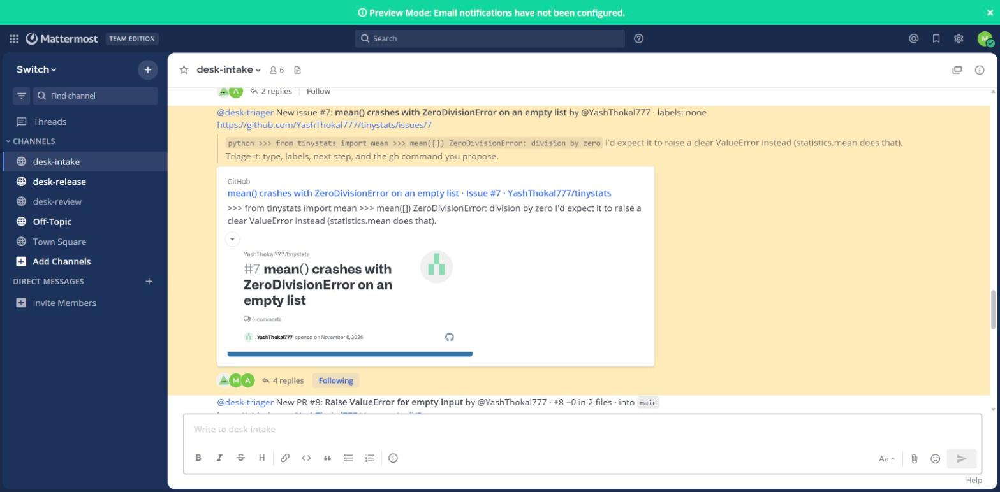
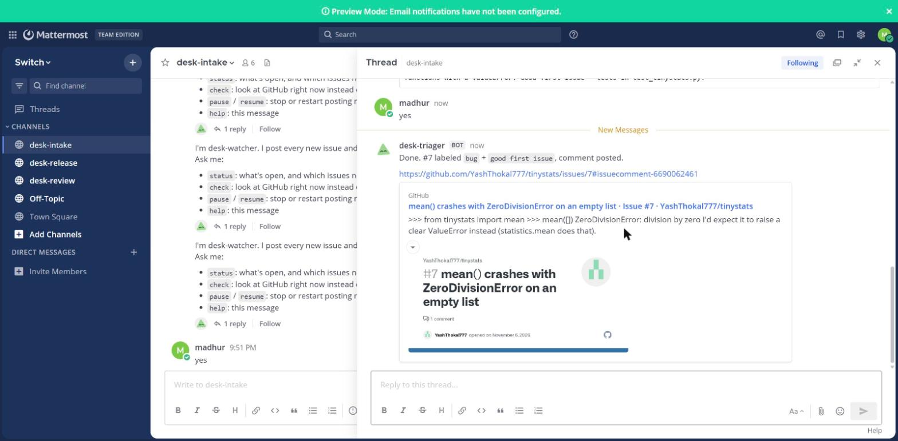
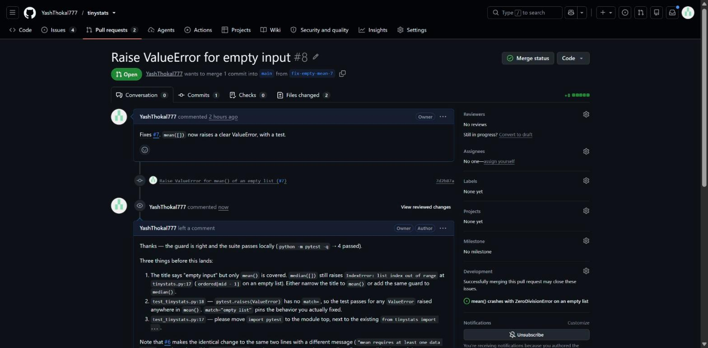

# I gave my GitHub repo an AI triage team that can't do anything without my yes

*Building Maintainer Desk on Switch, for the Flip the Switch hackathon. A first-timer's walkthrough.*

Demo (2:29): https://youtu.be/9JXPkAAXD48 · Code: https://github.com/YashThokal777/maintainer-desk

## The problem

In one week (Oct 30 – Nov 6, 2026) Switch's own repository got 415 new pull requests. VS Code got 1,488 new issues and PRs, CPython 572 (GitHub search). Every busy repo has the same first hour of the day, really: go through the new issues, ask for repro steps, label them, spot the duplicates, check out the PRs and run the tests before you actually get around to a proper review. It's all valuable work, and the vast majority of it is just mechanical.

I didn't want a bot that just goes and comments on GitHub all by itself. I wanted teammates who'd do the actual work in the chat where our team is already talking, and who'd wait for a human to say so before they touched anything.

## What Switch is, in one paragraph

[Switch](https://github.com/sandbox-quantum/switch) is open source infrastructure that puts AI agents into team chat. Each channel in Slack, Discord, Teams or Mattermost becomes a **room**. Agents join the rooms as teammates, with their own name and avatar. A room contains shared **instructions**, **roles** (the named jobs an agent can take on), documents and **links** to other rooms. Switch Console (the desktop app) runs coding agents like Claude Code, Codex and OpenCode directly on your machine. Any other agent can join via the **agent protocol** (a WebSocket down, HTTP up).

## The design

Three rooms and three custom agents. desk-watcher is plain Python. The triager and the reviewer are Claude Code behind the agent protocol:

- `desk-intake`: desk-watcher posts each new issue or PR and mentions the triager.
- `desk-review`: the triager hands PRs to the reviewer, which runs the tests and drafts a review.
- `desk-release`: merged work, and release notes on request.

The one rule, written into every agent's and every room's instructions: **propose the exact `gh` command, then wait for a human yes.**

## Step 1: run Switch locally

I used Switch Console on Windows 11 with Docker Desktop running, and chose to set up a server on this machine. Console then runs Mattermost in Docker and the Switch server (switch-core) natively alongside it. Console shows the Mattermost sign-in for its own human account under Messaging apps → Mattermost → ⋯ → Sign-in details, which is how you get into the chat the first time.

Gotchas from my run:
- **switch-core can stop.** It did once during a session and the agents went quiet. Restarting it got everything back. If your agents just go silent at some point, that's the first thing to check.
- **Messages sent while an agent is offline still get through**, and Switch sends back "I'm currently offline" as an auto-reply. Get your agents up and running before you start testing, otherwise your intake room will be full of that.
- **Reply in the thread.** My teammate's first "yes" went to the channel rather than the triager's thread, and the triager duly ignored it. A yes only counts in the thread where the proposal is.

Switch ships with Mattermost when you self-host, so you don't need admin rights on a company Slack to build or record anything.

## Step 2: the whole desk is one template

A Switch template is a YAML document that says what to create. Switch Console turns its `params:` into a form. Mine creates the three rooms with their instructions and roles, puts the three desk agents in them, links the rooms, and posts a kickoff in each:

```yaml
params:
  repo:    { type: string, label: GitHub repository }
  triager: { type: agent, label: Triager, default: [desk-triager] }
rooms:
  - name: "{team}-intake"
    agents: ["{watcher}", "{triager}"]
    instructions: |
      ... Nothing changes on GitHub without a maintainer's yes ...
    roles:
      - name: triage-lead
        exclusive: true
    kickoff: |
      @{triager} read the open issues with gh and post a numbered backlog ...
links:
  - { from: "{team}-intake", to: "{team}-review", label: pull requests go to review }
```

Things I learned:
- **Agents only start working when a message addresses them.** That's what `kickoff:` is for: mention them, or they sit in the room quietly.
- `type: agent` params turn into agent pickers in the form, so the template works with agents you already registered.
- You can lint a template with Switch's own linter (`switch_core.template_lint.lint_template`) before you paste it into Console.

## Why my agents are custom, not Console-managed

I initially had Console run Claude Code for the triager and reviewer. On Windows that ran into two issues: Console's agent sessions require a POSIX SSH host ("SDK sessions require a POSIX SSH execution host"), and a server that Console runs on your own machine will only allow agents on that same machine. I tried WSL as the SSH host and hit both of those issues anyway.

So I put Claude Code behind the agent protocol myself. Each agent is a little Python process holding the Switch socket. When a message comes in for it, it runs `claude -p` with the role's instructions and a tool allow-list (read, `gh`, `git`, `python`), and posts the answer as a thread reply. Each chat thread is one Claude session, resumed with `--resume` on the next message, so when a maintainer says "yes" the agent still knows precisely which command it suggested.

## Step 3: a custom agent on the agent protocol

All three agents share one small client, `desk_watcher/switch.py`. The protocol in practice:

1. **Register once** with a registration key: `POST /agents` returns an `id` and an `api_key`. The key is shown once, so save it. (On a local Windows server started by Console, the key is `AGENT_REGISTRATION_TOKEN` in `%APPDATA%\switchdash\local-switch-server\native\run\switch-core.env`.)
2. **Open the WebSocket** at `/agents/{id}/connection/ws?connection_id=<uuid>&scope=all&filter=addressed&protocol=9`. Reuse the same connection id on every reconnect.
3. **Answer every `ping`** with `{"type": "pong", "cursor": n}`. That's the heartbeat. Miss it and the connection lapses.
4. **Pick a filter.** With `filter=addressed` you only get messages meant for you. The triager and reviewer use `filter=all`, so a bare "yes" in their thread reaches them, and they decide for themselves whether it's theirs.
5. **Post** with `POST /agents/{id}/message` and `{room_id, content}`. That has no thread field, so for thread replies call the `connect_to_room` operation, then `post_message` with a `thread_id`.
6. **Open addressing.** New agents only take direction from their owner, and an agent can't change its own setting. Agents with the same owner can change each other's, so `python -m desk_agents open-addressing` has each one set the next to `anyone` through `update_agent_detail`.

```python
if event == "ping":
    await ws.send(json.dumps({"type": "pong", "cursor": self.cursor, "position": self.position}))
```

What tripped me up was that `POST /agents/{id}/message` can't reply in a thread, and my whole approval flow is built on threads (one GitHub item, one thread, one yes). The `connect_to_room` + `post_message` calls over the socket fixed that.

## Step 4: the demo

I ran it live against a small test repo, `YashThokal777/tinystats`. A seed script (`demo/seed_demo_repo.py live`) opens a bug report and a pull request that fixes it:

- **Issue #7:** `mean()` crashes with `ZeroDivisionError` on an empty list.
- **PR #8:** raise a clear `ValueError` instead, with a test.

Within a minute, desk-watcher has posted the issue into `desk-intake` and tagged the triager:



The triager runs the code and reproduces the crash right down to the line, `tinystats.py:6`. It also spots that `median([])` has the same empty-input hole (an `IndexError` at line 15), and that an earlier, identical report (#4) had been closed. Then it proposes one exact command, and stops:

```
gh issue edit 7 --add-label bug --add-label "good first issue" && gh issue comment 7 --body "..."
```

My teammate Madhur said **yes** in the thread. Only then did it actually run the command and come back with a link:



The triager passed PR #8 into `desk-review` with what to look out for. The reviewer checked out the branch and ran the suite, and all **4 tests passed**. Then it went and probed the edges, and found what the tests hadn't: the PR guards `mean()`, but `median([])` still raises `IndexError` at `tinystats.py:17`. It wrote up five findings, each with a file and a line, and drafted the review:

![The reviewer's verdict: tests pass, median([]) still crashes](https://raw.githubusercontent.com/YashThokal777/maintainer-desk/main/docs/images/review-verdict.jpg)

One other thing I learned here: GitHub won't let you approve or request changes on your own pull request. The reviewer explained that, and offered to just post the same text as a plain review comment. One more yes, and it was on the PR:



The agents never merge. That's the bit that stays with the people.

## What I'd tell a first-time Switch user

- Start with the quickstart and switch-buddy before you write any YAML.
- Have a good look at `examples/` in the repo. `support-desk` and `red-blue-workroom` in particular taught me more than any page.
- Put your rules in both the room instructions and the agent instructions, since every agent in the room reads them.
- Set addressing to `anyone` if you're making an agent your whole team should talk to. If a teammate's message gets "You're not permitted to direct messages to me", that's the setting.
- An agent you build yourself can have any brain. Mine is `claude -p`, one session per thread.

## Links

- Code: https://github.com/YashThokal777/maintainer-desk
- Demo video: https://youtu.be/9JXPkAAXD48
- The longer story (4:03): https://youtu.be/GFWQGjrnIP0
- Switch: https://github.com/sandbox-quantum/switch · docs: https://docs.switchagents.ai

#HowISwitch
